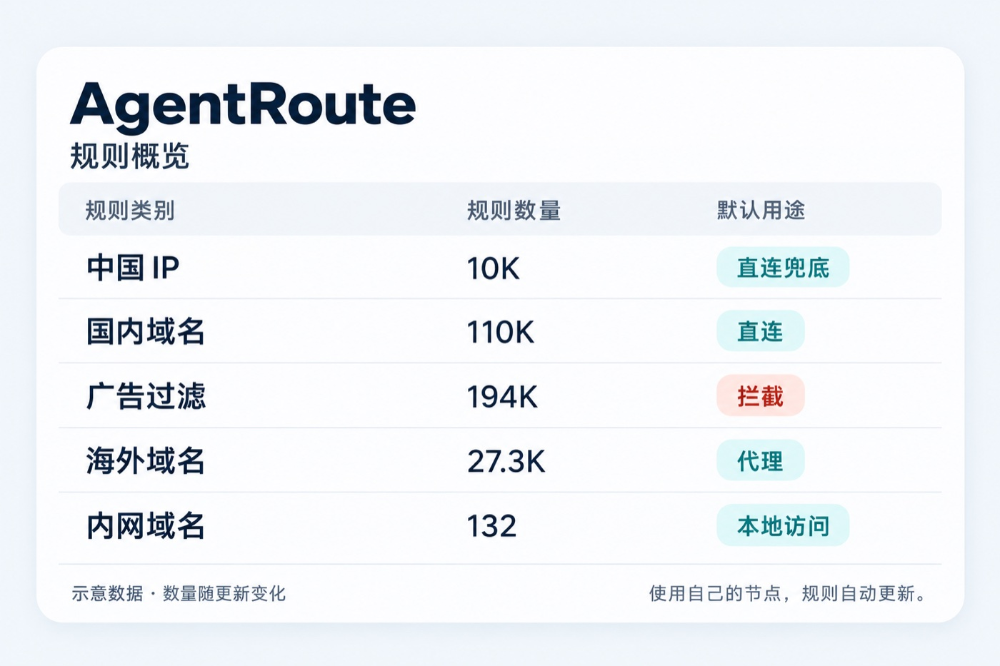

# AgentRoute · 智能体分流规则

[](https://github.com/ryuu-restart/agent-route/actions/workflows/run.yml)

**自动更新分流规则，用你自己的节点，让你的 Agent 处理规则、DNS 和 WebRTC，并逐项验证。**

[复制提示词](#agent-prompt) · [Agent 执行流程](AGENTS.md) · [DNS / WebRTC 验收](docs/DNS-WEBRTC.md)

> [!IMPORTANT]
> 推荐使用 ChatGPT 6.1 Sol Xhigh 或更高智能水平的 Agent 来操作。接入需要读取资料、操作目标设备并验证结果；碰不到设备的聊天工具只能提供指导。

<a id="about"></a>

## 这是什么？

AgentRoute 整理国内、海外、内网、广告域名和中国 IP 名单，提供 Mihomo、Surge / Shadowrocket、sing-box 可用的规则格式。国内流量通常直连，海外流量使用你自己的代理节点。它不提供节点、机场订阅或代理客户端。

项目维护规则和执行规范；具体配置由你的 Agent 根据实际客户端、核心和浏览器版本完成。[模板](examples/README.md)只是可选参考，不能保证原样适用于所有设备或未来版本。



*规则数量以[最新发布清单](https://raw.githubusercontent.com/ryuu-restart/agent-route/release/manifest.json)为准。*

<a id="agent-prompt"></a>

## 复制给自己的 Agent

准备好自己的节点和代理客户端，再复制下面整段。接入要求 TUN 或经核实的等效系统隧道；尚未启用时，Agent 会先指导你开启和确认。

```text
请帮我接入 AgentRoute，处理规则、DNS 和 WebRTC，并逐项验证：
https://github.com/ryuu-restart/agent-route

先阅读这三份文档，以 AGENTS 为主流程：
https://raw.githubusercontent.com/ryuu-restart/agent-route/master/AGENTS.md
https://raw.githubusercontent.com/ryuu-restart/agent-route/master/docs/CLIENTS.md
https://raw.githubusercontent.com/ryuu-restart/agent-route/master/docs/DNS-WEBRTC.md

识别我的实际环境和版本，查询对应的官方资料完成适配，不必照搬模板或安装示例中的版本。先检查，已符合目标的配置保留；需要修改时先备份并给我可独立操作的恢复方法。保留我的节点、订阅和用户例外，不中断现用代理来做对照。碰不到设备或需要我操作时，给出具体下一步。

最后分别报告规则、DNS、WebRTC 的通过/失败/未验证/不适用，以及改动、恢复方法和剩余问题，不把配置检查成功当作真实验收通过。
```

规则名单通常由客户端自动刷新；模板和说明的变化要持续跟进[提交记录](https://github.com/ryuu-restart/agent-route/commits/master)。自动或手动跟进方式由使用者决定。

## 资料与来源

[执行流程](AGENTS.md) · [客户端适配原则](docs/CLIENTS.md) · [DNS / WebRTC 目标与验收](docs/DNS-WEBRTC.md) · [可选示例](examples/README.md) · [同步与回退工具](docs/SYNC.md) · [维护说明](docs/MAINTAINING.md)

本项目基于 [Loyalsoldier](https://github.com/Loyalsoldier)、[v2fly](https://github.com/v2fly/domain-list-community)、[gaoyifan](https://github.com/gaoyifan/china-operator-ip) 等作者和社区的成果。完整来源、处理方式和许可见 [NOTICE](NOTICE.md)、[sources.json](sources.json) 与 [licenses](licenses/)。本项目的 [LICENSE](LICENSE) 不替代上游各自的声明。
